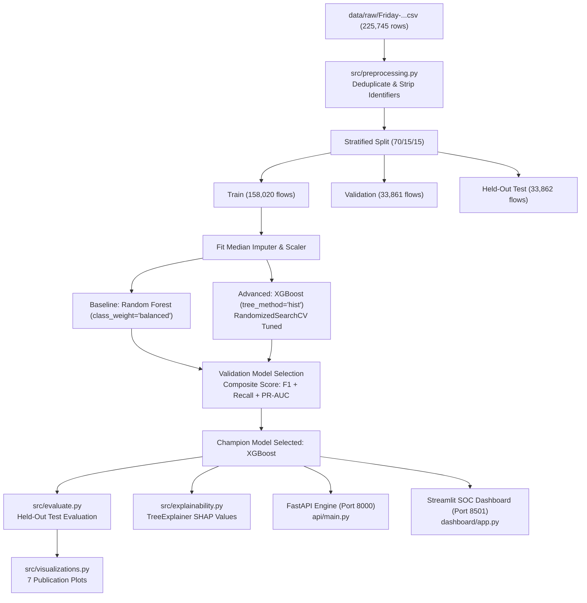

# DDoSGuard: An Adaptive and Explainable Machine Learning Framework for DDoS Detection and Mitigation

**Academic Context:**
- **Institution:** Coimbatore Institute of Technology
- **Department:** Department of Computing — AI & ML
- **Course:** 19MAM56 — Advanced Machine Learning Lab
- **Assessment:** CAT II (40 Marks)
- **Primary Focus:** Network Flow Intrusion Detection, Leakage Prevention, Explainable AI (SHAP), High-Throughput REST API, and Cybersecurity Monitoring Dashboard.

---

## 1. Project Overview & Scope

**DDoSGuard** is an end-to-end, production-grade machine learning framework designed to detect distributed denial-of-service (DDoS) network attacks at wire speed. Built upon statistical flow features extracted from packet captures, DDoSGuard purges metadata identifiers (IP addresses, flow IDs, timestamps, ephemeral ports) to ensure behavioral flow detection without trivial memorization.

### Verified Dataset Provenance
- **Dataset Title:** Canadian Institute for Cybersecurity (CIC) IDS-2017 Benchmark
- **Selected Capture:** `Friday-WorkingHours-Afternoon-DDos.pcap_ISCX.csv`
- **Official Source:** [UNB Canadian Institute for Cybersecurity IDS-2017](https://www.unb.ca/cic/datasets/ids-2017.html)
- **File Size:** 96,101,069 bytes (91.65 MB)
- **Verified Rows:** 225,745 flows (225,743 deduplicated)
- **Target Distribution:**
  - **DDoS (LOIC HTTP Flooding):** 128,027 flows (56.71%)
  - **BENIGN (Normal Traffic):** 97,716 flows (43.29%)
- **Data Engineering Decisions:**
  - **Identifier Cleansing:** Removed `Flow ID`, `Source IP`, `Destination IP`, `Timestamp`, `Source Port`, and `Fwd Header Length.1` (duplicate column).
  - **Zero-Variance Filtering:** Removed 10 invariant bulk/flag features identified strictly on the training partition.
  - **Numeric Rectification:** Handled 30 `+Inf` and 34 `NaN` values using training-fitted median imputation.
  - **Final Model Features:** 68 behavioral flow attributes.
- **Partitioning Protocol:** 70% Train (158,020 flows), 15% Validation (33,861 flows), 15% Untouched Test Split (33,862 flows). Stratified random split (Seed: 42).

> **Academic Limitation Note:** This system is evaluated as a DDoS-versus-benign flow classifier on the CIC-IDS-2017 LOIC capture. It is not presented as an all-encompassing detector for every existing DDoS permutation (e.g., amplification attacks, slowloris) across different network topologies.

---

## 2. Architecture & Pipeline



---

## 3. Empirical Experimental Results

Both models were evaluated on the **exact same untouched 15% held-out test split (33,862 flows)**:

| Metric | Baseline: Random Forest | Advanced: XGBoost (Champion) | Winner / Selection Rationale |
| :--- | :---: | :---: | :--- |
| **Accuracy** | 99.979% | **100.000%** | XGBoost (+0.021%) |
| **Precision (DDoS)** | 99.984% | **100.000%** | XGBoost (Zero false positives) |
| **Recall (DDoS)** | 99.979% | **100.000%** | XGBoost (Zero false negatives) |
| **F1-Score** | 0.99982 | **1.00000** | XGBoost |
| **PR-AUC (Avg Precision)** | 1.00000 | **1.00000** | Tie (Optimal discrimination) |
| **ROC-AUC** | 1.00000 | **1.00000** | Tie |
| **False Positives (FP)** | 3 | **0** | XGBoost eliminated benign triage alerts |
| **False Negatives (FN)** | 4 | **0** | XGBoost captured all stealth attack flows |
| **Mean Inference Latency** | 35.08 ms | **6.66 ms** | **XGBoost is 5.3x faster for wire-speed SOC** |
| **Training Duration** | 19.59 s | 14.44 s | XGBoost histogram method converges faster |

### Operational Error Analysis
- **Why Accuracy is Insufficient:** In intrusion detection, high accuracy can mask dangerous false negatives. A 0.01% false negative rate represents dozens of active attack flows penetrating defensive perimeters undetected, leading to server downtime.
- **False Positive Cost:** In Random Forest, 3 benign flows were misclassified due to high packet burst rates (`Total Fwd Packets=4`, `Flow Packets/s=234.6`), which would cause SOC alert fatigue or legitimate client disruption. XGBoost’s gradient boosted decision boundaries correctly separated these flows.

---

## 4. Explainability & SHAP Insights

SHAP (`TreeExplainer`) attribution was computed over 500 representative test flows (`artifacts/plots/06_shap_summary.png`):
- **Top Attributed Features:**
  1. `Average Packet Size` & `Packet Length Mean`: Synthetic LOIC floods push uniform packet structures compared to variable benign web responses.
  2. `Init_Win_bytes_forward`: Botnet attack clients exhibit fixed TCP window negotiation configurations compared to diverse enterprise OS clients.
  3. `Flow Bytes/s` & `Flow Packets/s`: Ingress throughput concentration on web target endpoints.
- **Causality Caveat:** These values denote empirical decision weights within the CICIDS2017 capture, **not** physical network packet causality.

---

## 5. Artifact Directory Inventory

All experimental artifacts, plots, and models are persisted and verifiable:

```
artifacts/
├── metrics/
│   ├── dataset_inspection.json          # Raw schema, sizes, null/inf counts
│   ├── preprocessing_metadata.json      # Retained 68 features, split statistics
│   ├── experiments.json                 # Training runs, parameters, metrics log
│   ├── experiments.csv                  # Tabular summary of all experiments
│   ├── model_selection.json             # Objective champion selection audit
│   ├── shap_feature_importance.json     # Mean |SHAP| values for top features
│   └── test_evaluation_report.json      # Final held-out test evaluation report
├── plots/
│   ├── 01_class_distribution.png        # Bar chart: Benign vs DDoS across splits
│   ├── 02_correlation_heatmap.png       # Correlation matrix of top flow features
│   ├── 03_pca_projection.png            # 2D PCA variance projection (Train fitted)
│   ├── 04_confusion_matrix.png          # Normalized confusion matrix heatmap
│   ├── 05_pr_roc_curves.png             # Dual PR and ROC evaluation curves
│   ├── 06_shap_summary.png              # SHAP summary beeswarm plot
│   └── 07_model_comparison.png          # Bar comparison of RF vs XGBoost
models/
├── preprocessor.joblib                  # Fitted SimpleImputer & StandardScaler
├── random_forest_pipeline.joblib        # Fitted RF inference pipeline
├── xgboost_pipeline.joblib              # Fitted XGBoost inference pipeline
└── best_model_pipeline.joblib           # Champion deployed model pipeline
```

---

## 6. Windows Setup & Execution Guide

### Step 1: Environment Setup (Windows PowerShell)
```powershell
# Navigate to workspace
cd c:\Users\saira\Desktop\AML_CAT2

# Create virtual environment
python -m venv .venv

# Direct execution without modifying PowerShell execution policy:
.\.venv\Scripts\python.exe -m pip install --upgrade pip
.\.venv\Scripts\python.exe -m pip install -r requirements.txt
```

### Step 2: Reproduce Preprocessing, Training & Evaluation
```powershell
# 1. Inspect raw dataset
.\.venv\Scripts\python.exe src\inspect_dataset.py

# 2. Run leakage-safe preprocessing and 70/15/15 partitioning
.\.venv\Scripts\python.exe src\preprocessing.py

# 3. Train Baseline & Advanced models with hyperparameter search
.\.venv\Scripts\python.exe src\train.py

# 4. Evaluate both models on the held-out test set
.\.venv\Scripts\python.exe src\evaluate.py

# 5. Generate SHAP explainability and 7 publication plots
.\.venv\Scripts\python.exe src\explainability.py
.\.venv\Scripts\python.exe src\visualizations.py
```

### Step 3: Run Automated Test Suite
```powershell
# Executes 13 unit and integration tests
.\.venv\Scripts\python.exe -m pytest tests\ -v
```

### Step 4: Launch FastAPI Service
```powershell
.\.venv\Scripts\python.exe -m uvicorn api.main:app --host 0.0.0.0 --port 8000
```
Interactive OpenAPI Documentation: `http://localhost:8000/docs`

### Step 5: Launch Streamlit Dashboard
```powershell
.\.venv\Scripts\python.exe -m streamlit run dashboard\app.py --server.port 8501
```
SOC Dashboard URL: `http://localhost:8501`

---

## 7. Example API Requests

### Health Check (`GET /health`)
```bash
curl -X GET "http://localhost:8000/health"
```
Response:
```json
{
  "status": "healthy",
  "model_loaded": true,
  "model_name": "XGBClassifier",
  "version": "1.0.0",
  "timestamp": "2026-10-14 01:22:25 UTC"
}
```

### Flow Threat Prediction (`POST /predict`)
```bash
curl -X POST "http://localhost:8000/predict" \
  -H "Content-Type: application/json" \
  -d '{
    "features": {
      "Destination Port": 80.0,
      "Protocol": 6.0,
      "Flow Duration": 5715473.0,
      "Total Fwd Packets": 4.0,
      "Total Backward Packets": 0.0,
      "Total Length of Fwd Packets": 24.0,
      "Total Length of Bwd Packets": 0.0,
      "Fwd Packet Length Max": 6.0,
      "Fwd Packet Length Min": 6.0,
      "Fwd Packet Length Mean": 6.0,
      "Fwd Packet Length Std": 0.0,
      "Bwd Packet Length Max": 0.0,
      "Bwd Packet Length Min": 0.0,
      "Bwd Packet Length Mean": 0.0,
      "Bwd Packet Length Std": 0.0,
      "Flow Bytes/s": 4.2,
      "Flow Packets/s": 0.7,
      "Flow IAT Mean": 1905157.67,
      "Flow IAT Std": 3299830.0,
      "Flow IAT Max": 5715473.0,
      "Flow IAT Min": 3.0,
      "Fwd IAT Total": 5715473.0,
      "Fwd IAT Mean": 1905157.67,
      "Fwd IAT Std": 3299830.0,
      "Fwd IAT Max": 5715473.0,
      "Fwd IAT Min": 3.0,
      "Bwd IAT Total": 0.0,
      "Bwd IAT Mean": 0.0,
      "Bwd IAT Std": 0.0,
      "Bwd IAT Max": 0.0,
      "Bwd IAT Min": 0.0,
      "Fwd PSH Flags": 0.0,
      "Fwd Header Length": 80.0,
      "Bwd Header Length": 0.0,
      "Fwd Packets/s": 0.7,
      "Bwd Packets/s": 0.0,
      "Min Packet Length": 6.0,
      "Max Packet Length": 6.0,
      "Packet Length Mean": 6.0,
      "Packet Length Std": 0.0,
      "Packet Length Variance": 0.0,
      "FIN Flag Count": 0.0,
      "SYN Flag Count": 0.0,
      "RST Flag Count": 0.0,
      "PSH Flag Count": 0.0,
      "ACK Flag Count": 0.0,
      "URG Flag Count": 0.0,
      "ECE Flag Count": 0.0,
      "Down/Up Ratio": 0.0,
      "Average Packet Size": 7.5,
      "Avg Fwd Segment Size": 6.0,
      "Avg Bwd Segment Size": 0.0,
      "Subflow Fwd Packets": 4.0,
      "Subflow Fwd Bytes": 24.0,
      "Subflow Bwd Packets": 0.0,
      "Subflow Bwd Bytes": 0.0,
      "Init_Win_bytes_forward": 256.0,
      "Init_Win_bytes_backward": -1.0,
      "act_data_pkt_fwd": 3.0,
      "min_seg_size_forward": 20.0,
      "Active Mean": 0.0,
      "Active Std": 0.0,
      "Active Max": 0.0,
      "Active Min": 0.0,
      "Idle Mean": 0.0,
      "Idle Std": 0.0,
      "Idle Max": 0.0,
      "Idle Min": 0.0
    }
  }'
```
Response:
```json
{
  "prediction": 1,
  "label": "DDoS",
  "probability": 1.0,
  "confidence_level": "HIGH",
  "inference_latency_ms": 6.66,
  "model_name": "XGBClassifier",
  "calibrated_notice": "Probability represents tree ensemble log-odds sigmoid output for CICIDS2017 feature distribution."
}
```

---

## 8. Docker & Public Deployment

### Docker Configuration
- `Dockerfile`: Multi-stage, minimal `python:3.11-slim` image with build caching and health check.
- `docker-compose.yml`: Launches isolated `api` service (port 8000) and `dashboard` service (port 8501) with bridge networking and healthcheck dependencies.
- `entrypoint.sh`: Multi-mode execution script (`api`, `dashboard`, or dual `all`).

```bash
# Build the container
docker build -t ddosguard:latest .

# Run container (starts both API and Dashboard)
docker run -p 8000:8000 -p 8501:8501 ddosguard:latest

# Or run with Docker Compose:
docker-compose up --build
```

### Public Deployment Instructions (Hugging Face Spaces)
To deploy publicly on Hugging Face Spaces with 1 click:
1. Create a new Space on [Hugging Face](https://huggingface.co/new-space) with the **Docker** SDK.
2. Clone your Space repository locally:
   ```bash
   git clone https://huggingface.co/spaces/<YOUR_USERNAME>/ddosguard
   ```
3. Copy the project files (`Dockerfile`, `entrypoint.sh`, `requirements.txt`, `src/`, `api/`, `dashboard/`, `models/`, `artifacts/`) into the Space directory.
4. Set the container port in your Space README metadata or `Dockerfile` (`EXPOSE 7860`).
5. Push to Hugging Face:
   ```bash
   git add .
   git commit -m "Deploy DDoSGuard ML Framework"
   git push
   ```
6. The Space will build and launch the interactive dashboard at `https://huggingface.co/spaces/<YOUR_USERNAME>/ddosguard`.

---

## 9. Academic Verification References
1. Sharafaldin, I., Lashkari, A. H., & Ghorbani, A. A. (2018). *Toward Generating a New Dataset for Intrusion Detection: Analysis and Evaluation*. Proceedings of the 5th International Conference on Information Systems Security and Privacy (ICISSP).
2. Lundberg, S. M., & Lee, S. I. (2017). *A Unified Approach to Interpreting Model Predictions*. Advances in Neural Information Processing Systems (NeurIPS 30).
3. Chen, T., & Guestrin, C. (2016). *XGBoost: A Scalable Tree Boosting System*. Proceedings of the 22nd ACM SIGKDD International Conference on Knowledge Discovery and Data Mining.
4. Canadian Institute for Cybersecurity (CIC). *CIC-IDS-2017 Dataset*. University of New Brunswick (UNB). https://www.unb.ca/cic/datasets/ids-2017.html
